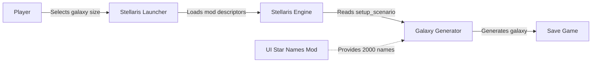
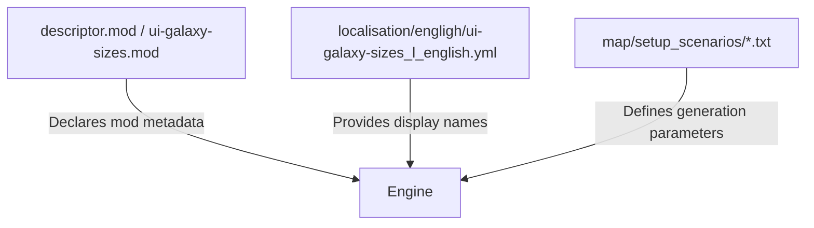
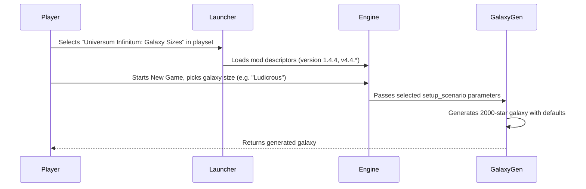
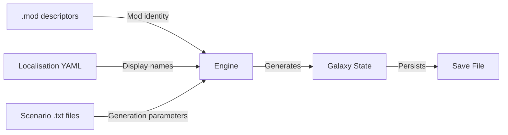
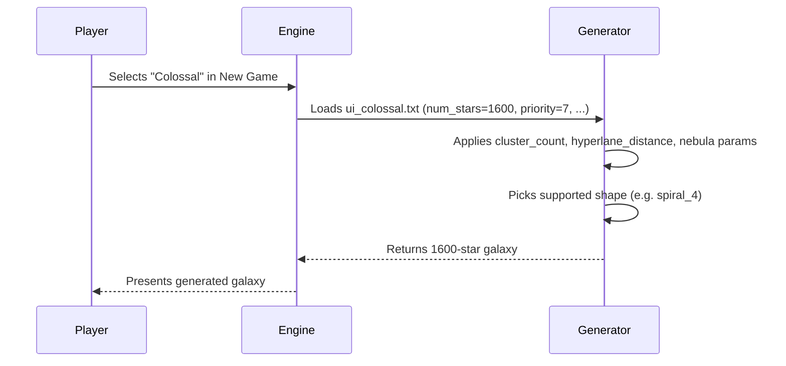
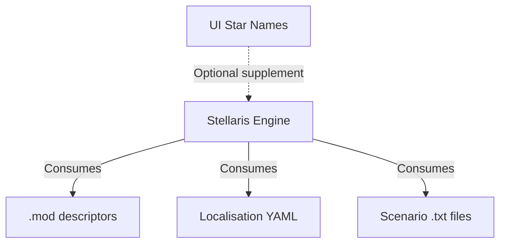

# Universum Infinitum: Galaxy Sizes Architecture

This document describes the current architecture of the Stellaris mod "Universum Infinitum: Galaxy Sizes". The mod is a data-driven extension that adds six galaxy-size scenarios to the Stellaris galaxy generator.

## 📑 Table of Contents

- [Purpose](#-purpose)
- [System Context](#-system-context)
- [Architectural Style](#-architectural-style)
- [Runtime Flow](#-runtime-flow)
- [Components](#-components)
- [Architectural Areas](#-architectural-areas)
- [Data Architecture](#-data-architecture)
- [Interfaces and Integrations](#-interfaces-and-integrations)
- [Key Flows](#-key-flows)
- [Cross-Cutting Concerns](#-cross-cutting-concerns)
- [Dependency Direction and Rules](#-dependency-direction-and-rules)
- [External Dependencies](#-external-dependencies)
- [Deployment and Operations](#-deployment-and-operations)
- [Compatibility Contracts](#-compatibility-contracts)
- [Testing and Verification](#-testing-and-verification)

## 🎯 Purpose

The mod extends Stellaris galaxy generation by providing six additional galaxy-size scenarios ranging from 100 to 2,000 stars. Each scenario defines generation defaults for AI empires, fallen empires, marauders, advanced empires, nebulae, crisis strength, hyperlane topology, and supported galaxy shapes. The mod is purely declarative; it contains no executable code.

## 🌐 System Context



The principal external boundaries are:
- **Stellaris Launcher:** Loads `ui-galaxy-sizes.mod` and `descriptor.mod` to register the mod and its supported game version (`v4.4.*`).
- **Stellaris Engine:** Parses `setup_scenario` definitions from `map/setup_scenarios/` at galaxy generation time.
- **Universum Infinitum: Star Names (optional):** Supplies additional system names required by the 2,000-star Ludicrous scenario.

## 🏗️ Architectural Style

**Declarative data-driven mod** — The mod consists entirely of static configuration files consumed by the Stellaris engine. There is no runtime logic, no scripting layer, and no compiled artefacts. The engine owns all execution; the mod only supplies parameters.



The principal architecture boundaries are:
- **Mod Descriptors:** Define mod identity, version, supported game version, and filesystem path.
- **Localisation:** Maps scenario keys to human-readable labels.
- **Scenario Definitions:** Each file in `map/setup_scenarios/` is a self-contained `setup_scenario` block consumed directly by the galaxy generator.

## 🔄 Runtime Flow



The principal runtime sequence is:
1. Launcher reads both `.mod` descriptors and registers the mod for Stellaris `v4.4.*`.
2. Player selects a galaxy size from the six added options in the New Game screen.
3. Engine loads the corresponding `setup_scenario` file (e.g., `ui_ludicrous.txt`).
4. Galaxy generator applies all parameters (star count, empire limits, crisis strength, hyperlane settings, supported shapes).
5. Optional: If Ludicrous is selected and UI Star Names is active, generator draws from the extended name pool.

## 🧩 Components

| Component | Responsibility | Principal Dependencies | Lifetime or Ownership |
|-----------|----------------|------------------------|-----------------------|
| `ui-galaxy-sizes.mod` | Root mod descriptor for Steam Workshop / GitHub / Nexus Mods distribution | Stellaris launcher mod loader | Static file, owned by mod author |
| `descriptor.mod` | Local mod descriptor for Paradox Mods / manual installation | Stellaris launcher mod loader | Static file, owned by mod author |
| `localisation/engligh/ui-galaxy-sizes_l_english.yml` | English display names for the six galaxy sizes | Stellaris localisation system | Static file, owned by mod author |
| `map/setup_scenarios/ui_minuscule.txt` | 100-star scenario (priority -1) | Stellaris galaxy generator | Static file, owned by mod author |
| `map/setup_scenarios/ui_gigantic.txt` | 1,200-star scenario | Stellaris galaxy generator | Static file, owned by mod author |
| `map/setup_scenarios/ui_immense.txt` | 1,400-star scenario | Stellaris galaxy generator | Static file, owned by mod author |
| `map/setup_scenarios/ui_colossal.txt` | 1,600-star scenario | Stellaris galaxy generator | Static file, owned by mod author |
| `map/setup_scenarios/ui_titanic.txt` | 1,800-star scenario | Stellaris galaxy generator | Static file, owned by mod author |
| `map/setup_scenarios/ui_ludicrous.txt` | 2,000-star scenario (priority 9) | Stellaris galaxy generator; UI Star Names (optional) | Static file, owned by mod author |

## 🗂️ Architectural Areas

### Mod Metadata

Paths:
- `ui-galaxy-sizes.mod`
- `ui-galaxy-sizes/descriptor.mod`

Responsibilities:
- Declare mod name, version (1.4.4), supported game version (`v4.4.*`), tags, and filesystem path.

Boundary rules:
- Both descriptors must remain identical in version, name, and supported_version.
- Path must point to `mod/ui-galaxy-sizes` for Paradox Mods compatibility.

### Localisation

Paths:
- `ui-galaxy-sizes/localisation/engligh/ui-galaxy-sizes_l_english.yml`

Responsibilities:
- Provide `l_english` keys for each scenario (`ui_minuscule`, `ui_gigantic`, `ui_immense`, `ui_colossal`, `ui_titanic`, `ui_ludicrous`).

Boundary rules:
- Keys must match the `name` field in each `setup_scenario` file.
- Only English is currently provided; additional locales follow the same pattern.

### Galaxy Scenarios

Paths:
- `ui-galaxy-sizes/map/setup_scenarios/ui_minuscule.txt`
- `ui-galaxy-sizes/map/setup_scenarios/ui_gigantic.txt`
- `ui-galaxy-sizes/map/setup_scenarios/ui_immense.txt`
- `ui-galaxy-sizes/map/setup_scenarios/ui_colossal.txt`
- `ui-galaxy-sizes/map/setup_scenarios/ui_titanic.txt`
- `ui-galaxy-sizes/map/setup_scenarios/ui_ludicrous.txt`

Responsibilities:
- Define `num_stars`, `radius`, empire limits, fallen/marauder/advanced empire defaults, crisis strength, cluster settings, hyperlane topology, nebula counts, wormhole/gateway/hyperlane ranges, and supported galaxy shapes.

Boundary rules:
- Each file is independent; the engine selects by `name` and `priority`.
- All scenarios support the same ten galaxy shapes (elliptical, spiral_2/3/4/6, ring, bar, starburst, cartwheel, spoked).
- Parameter ranges must remain valid for the Stellaris `v4.4.*` generator.

## 💾 Data Architecture



| Data or Store | Owner | Representation and Storage | Lifecycle or Consistency |
|---------------|-------|----------------------------|--------------------------|
| Mod descriptors | Mod author | Clausewitz `.mod` format (UTF-8 text) | Immutable per release; updated on version bump |
| Localisation | Mod author | YAML `l_english:` mapping | Immutable per release; additive for new locales |
| Scenario definitions | Mod author | Clausewitz `setup_scenario` blocks (UTF-8 text) | Immutable per release; each file self-contained |
| Generated galaxy | Stellaris engine | Internal runtime state → binary save | Created per game; persists in save file |

## 🔌 Interfaces and Integrations

| Interface or Integration | Direction | Contract | Owner | Failure Semantics |
|--------------------------|-----------|----------|-------|-------------------|
| Stellaris Launcher mod loading | Inbound | `.mod` descriptor format, `supported_version="v4.4.*"` | Stellaris launcher | Mod not listed / version mismatch |
| Stellaris Galaxy Generator | Inbound | `setup_scenario` schema (Clausewitz script) | Stellaris engine | Scenario ignored / fallback to vanilla sizes |
| UI Star Names (optional) | Outbound | Provides ≥2000 unique system names | UI Star Names mod | Ludicrous scenario reuses names / truncated pool |

## 🔀 Key Flows

### Galaxy Generation with Custom Size



Ordering and invariants:
- Scenario `priority` determines sort order in the UI (Minuscule = -1, Ludicrous = 9).
- All scenarios share identical `supports_shape` lists; shape selection is player-driven.
- Crisis strength scales with galaxy size (0.25 for Minuscule → 2.75 for Ludicrous).
- Empire limits scale proportionally (max 3 for Minuscule → max 60 for Ludicrous).

## ⚙️ Domain-Specific Concern: Scenario Parameter Scaling

The six scenarios form a progression where each parameter scales with `num_stars`:
- **Star count:** 100 → 2000 (×20)
- **Radius:** 100 → 500 (×5)
- **Max empires:** 3 → 60 (×20)
- **Fallen empire max:** 1 → 10 (×10)
- **Marauder max:** 1 → 6 (×6)
- **Advanced empire default:** 0 → 9
- **Crisis strength:** 0.25 → 2.75 (×11)
- **Nebula count:** 1 → 20 (×20)
- **Hyperlane density range:** 0.5–3 → 0.5–5

This scaling is hand-tuned per scenario; there is no algorithmic generator.

## 🧵 Cross-Cutting Concerns

### Security and Privacy

The mod contains no executable code, no network access, no file I/O beyond reading its own static assets, and no personal data. It defines only galaxy-generation parameters. The Stellaris engine sandboxes all mod content.

### Error Handling

- Missing or malformed `.mod` descriptor → launcher omits mod.
- Malformed `setup_scenario` → engine logs error and falls back to vanilla galaxy sizes.
- Missing localisation key → UI displays raw key (e.g., `ui_ludicrous`).
- UI Star Names absent when Ludicrous selected → name pool exhausted, duplicates appear.

### Observability

No logging, metrics, or telemetry are produced by the mod. The Stellaris engine may log scenario load events in its own `error.log`.

### Configuration

| Configuration Area | Source | Responsibility | Override or Secret Policy |
|--------------------|--------|----------------|---------------------------|
| Mod version | `ui-galaxy-sizes.mod` / `descriptor.mod` | Declares release version (1.4.4) | Updated manually per release |
| Supported game version | Both `.mod` files | `supported_version="v4.4.*"` | Updated when new Stellaris version validated |
| Scenario parameters | `map/setup_scenarios/*.txt` | All generation defaults | Static per release; no runtime override |
| Display names | `localisation/engligh/ui-galaxy-sizes_l_english.yml` | UI labels | Static per release; additive for locales |

## 🧭 Dependency Direction and Rules



The principal dependency rules are:
- Mod files depend only on the Stellaris engine schema (Clausewitz script / YAML).
- No mod file depends on another mod file (scenarios are independent).
- UI Star Names is an optional soft dependency; the mod functions without it (with name duplication in Ludicrous).

## 📦 External Dependencies

| Dependency | Responsibility | Integration Boundary | Architectural Consequence |
|------------|----------------|----------------------|---------------------------|
| Stellaris Engine `v4.4.*` | Executes galaxy generation using provided scenarios | Mod descriptors + scenario files | Mod must track engine schema changes across versions |
| UI Star Names (optional) | Supplies extended system-name pool | Stellaris name resolver | Only affects Ludicrous scenario; no hard requirement |

## 🚀 Deployment and Operations

| Concern | Current Design | Architectural Consequence |
|---------|----------------|---------------------------|
| Distribution | Four channels: Steam Workshop, Nexus Mods, Paradox Mods, GitHub Releases | Each channel consumes the same `ui-galaxy-sizes.mod` + `ui-galaxy-sizes/` directory |
| Installation | Launcher playset activation (Steam/Paradox) or manual extraction to `mod/` | No installer, no scripts, no dependencies beyond Stellaris |
| Persistent state | None (mod is read-only) | No migrations, no save-game coupling beyond engine-owned galaxy state |
| Startup | Launcher parses descriptors at playset load | Descriptor errors prevent mod activation |
| Scaling | Not applicable (static content) | N/A |

## 🛡️ Compatibility Contracts

| Contract | Owner | Invariant | Verification | Change Policy |
|----------|-------|-----------|--------------|---------------|
| Mod descriptor schema | Stellaris launcher | `version`, `name`, `path`, `supported_version`, `tags` present | Launcher validation on load | Update `supported_version` when new Stellaris major version validated |
| `setup_scenario` schema | Stellaris engine | All referenced fields valid for `v4.4.*` generator | Engine logs errors on malformed fields | Test each scenario in-game after Stellaris updates |
| Localisation key parity | Mod author | Every `name` in scenarios has a matching `l_english` key | Manual review / in-game UI check | Add keys when new scenarios added |
| UI Star Names name pool | UI Star Names mod | ≥2000 unique names for Ludicrous | In-game observation (duplicates indicate shortage) | Coordinate releases when name pool expanded |

## ✅ Testing and Verification

No automated test suite exists. Verification is manual:

1. Install mod via each distribution channel.
2. Launch Stellaris `v4.4.*` with mod active.
3. Start New Game, confirm all six galaxy sizes appear in selector.
4. Generate a galaxy for each size; verify star count, empire counts, crisis strength, and shape options match scenario files.
5. Test Ludicrous with and without UI Star Names; observe name duplication.

Execute the principal manual verification with:

```bash
# No automated commands; use Stellaris launcher and in-game UI
```