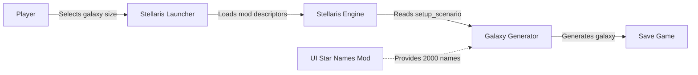
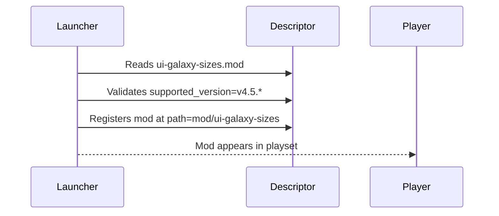
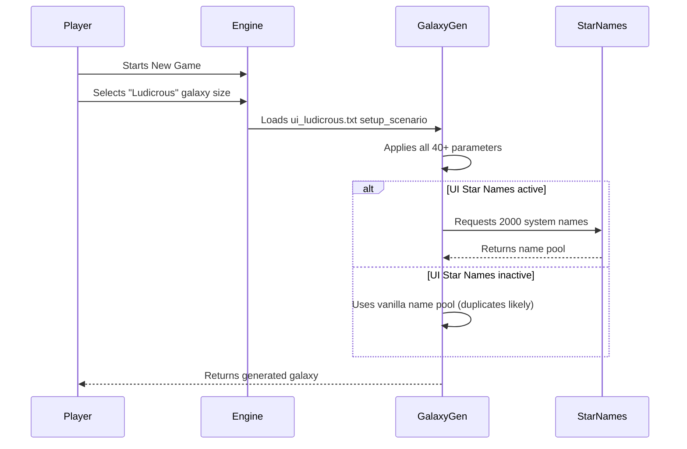

# Architecture

This document elaborates on the root `ARCHITECTURE.md` with implementation-level detail.

## Architectural Style

**Declarative data-driven Stellaris mod** — The mod consists entirely of static configuration files consumed by the Stellaris engine. There is no runtime logic, no scripting layer, no compiled artefacts, and no executable code. The engine owns all execution; the mod only supplies parameters.

## System Context



### External Boundaries

| Boundary | Description |
|----------|-------------|
| Stellaris Launcher | Loads `.mod` descriptors, validates `supported_version`, registers mod |
| Stellaris Engine | Parses `setup_scenario` blocks at galaxy generation time |
| Universum Infinitum: Star Names | Optional mod providing extended system name pool for 2,000-star galaxies |

## Component Catalogue

| Component | Type | Responsibility | Location |
|-----------|------|----------------|----------|
| Root Descriptor | Mod metadata | Declares mod identity, version, path, supported version | `ui-galaxy-sizes.mod` |
| Local Descriptor | Mod metadata | Alternative descriptor for Paradox Mods/manual install | `ui-galaxy-sizes/descriptor.mod` |
| Localisation | Display strings | Maps scenario keys to English labels | `localisation/engligh/ui-galaxy-sizes_l_english.yml` |
| Minuscule Scenario | Generation params | 100-star galaxy definition | `map/setup_scenarios/ui_minuscule.txt` |
| Gigantic Scenario | Generation params | 1,200-star galaxy definition | `map/setup_scenarios/ui_gigantic.txt` |
| Immense Scenario | Generation params | 1,400-star galaxy definition | `map/setup_scenarios/ui_immense.txt` |
| Colossal Scenario | Generation params | 1,600-star galaxy definition | `map/setup_scenarios/ui_colossal.txt` |
| Titanic Scenario | Generation params | 1,800-star galaxy definition | `map/setup_scenarios/ui_titanic.txt` |
| Ludicrous Scenario | Generation params | 2,000-star galaxy definition | `map/setup_scenarios/ui_ludicrous.txt` |

## Data Architecture

### Mod Descriptor Schema

Both `.mod` files share the same structure:

```text
version="1.4.5"
name="Universum Infinitum: Galaxy Sizes"
path="mod/ui-galaxy-sizes"
tags={ "Galaxy Generation" }
supported_version="v4.5.*"
```

| Field | Purpose | Constraints |
|-------|---------|-------------|
| `version` | Mod version | Must match release tag |
| `name` | Display name | Human-readable |
| `path` | Mount path | Must be `mod/ui-galaxy-sizes` |
| `tags` | Workshop categories | Array of strings |
| `supported_version` | Game version constraint | Stellaris version pattern |

### Localisation Schema

```yaml
l_english:
  ui_minuscule:0 "Minuscule"
  ui_gigantic:0 "Gigantic"
  ui_immense:0 "Immense"
  ui_colossal:0 "Colossal"
  ui_titanic:0 "Titanic"
  ui_ludicrous:0 "Ludicrous"
```

| Key | Format | Purpose |
|-----|--------|---------|
| `ui_<size>` | `key:0 "Label"` | Display name in galaxy size selector |

### Scenario Schema (`setup_scenario`)

All six scenarios share the same parameter structure:

```text
setup_scenario = {
    name = "ui_<size>"
    priority = <int>
    num_stars = <int>
    radius = <int>
    num_empires = { min = <int> max = <int> }
    num_empire_default = <int>
    fallen_empire_default = <int>
    fallen_empire_max = <int>
    marauder_empire_default = <int>
    marauder_empire_max = <int>
    advanced_empire_default = <int>
    colonizable_planet_odds = <float>
    primitive_odds = <float>
    crisis_strength = <float>
    extra_crisis_strength = { <int> <int> }

    cluster_count = {
        method = one_every_x_empire
        value = <int>
        max = <int>
    }
    cluster_radius = <int>
    cluster_distance_from_core = <int>

    max_hyperlane_distance = <int>

    home_system_partitions = {
        max_systems = <int>
        min_systems = <int>
        min_bridges = <int>
        max_bridges = <int>
        method = breadth_first
    }

    open_space_partitions = {
        max_systems = <int>
        min_systems = <int>
        min_bridges = <int>
        max_bridges = <int>
        method = depth_first
    }

    num_nebulas = <int>
    nebula_size = <int>
    nebula_min_dist = <int>

    num_wormhole_pairs = { min = <int> max = <int> }
    num_wormhole_pairs_default = <int>
    num_gateways = { min = <int> max = <int> }
    num_gateways_default = <int>
    num_hyperlanes = { min=<float> max=<float> }
    num_hyperlanes_default = <int>

    supports_shape = elliptical
    supports_shape = spiral_2
    supports_shape = spiral_3
    supports_shape = spiral_4
    supports_shape = spiral_6
    supports_shape = ring
    supports_shape = bar
    supports_shape = starburst
    supports_shape = cartwheel
    supports_shape = spoked
}
```

### Parameter Scaling Across Scenarios

| Parameter | Minuscule | Gigantic | Immense | Colossal | Titanic | Ludicrous |
|-----------|-----------|----------|---------|----------|---------|-----------|
| `priority` | -1 | 5 | 6 | 7 | 8 | 9 |
| `num_stars` | 100 | 1200 | 1400 | 1600 | 1800 | 2000 |
| `radius` | 100 | 460 | 470 | 480 | 490 | 500 |
| `num_empires.max` | 3 | 36 | 42 | 48 | 54 | 60 |
| `num_empire_default` | 3 | 18 | 21 | 24 | 27 | 30 |
| `fallen_empire_default` | 0 | 5 | 6 | 7 | 8 | 9 |
| `fallen_empire_max` | 1 | 6 | 7 | 8 | 9 | 10 |
| `marauder_empire_default` | 1 | 3 | 4 | 4 | 5 | 5 |
| `marauder_empire_max` | 1 | 4 | 4 | 5 | 5 | 6 |
| `advanced_empire_default` | 0 | 5 | 6 | 7 | 8 | 9 |
| `crisis_strength` | 0.25 | 1.75 | 2.0 | 2.25 | 2.5 | 2.75 |
| `cluster_count.max` | 2 | 6 | 6 | 6 | 6 | 6 |
| `cluster_radius` | 70 | 160 | 170 | 180 | 190 | 200 |
| `num_nebulas` | 1 | 12 | 14 | 16 | 18 | 20 |
| `num_hyperlanes.max` | 3 | 5 | 5 | 5 | 5 | 5 |

### Invariant Parameters (Same Across All Scenarios)

| Parameter | Value |
|-----------|-------|
| `colonizable_planet_odds` | 1.0 |
| `primitive_odds` | 1.0 |
| `extra_crisis_strength` | { 10 25 } |
| `cluster_count.method` | one_every_x_empire |
| `cluster_count.value` | 1 |
| `cluster_distance_from_core` | 70 (Minuscule), 300 (others) |
| `max_hyperlane_distance` | 50 |
| `home_system_partitions` | Identical across all |
| `open_space_partitions` | Identical across all |
| `nebula_size` | 60 |
| `nebula_min_dist` | 50 (Minuscule), 200 (others) |
| `num_wormhole_pairs` | { min = 0 max = 5 } |
| `num_wormhole_pairs_default` | 1 |
| `num_gateways` | { min = 0 max = 5 } |
| `num_gateways_default` | 1 |
| `num_hyperlanes.min` | 0.5 |
| `num_hyperlanes_default` | 1 |
| `supports_shape` | All 11 shapes |

## Interfaces and Integrations

### Stellaris Launcher Interface

- **Input**: `.mod` descriptor files
- **Output**: Mod registration, version validation
- **Contract**: `supported_version` must match running game version pattern

### Stellaris Engine Interface

- **Input**: `setup_scenario` blocks from `map/setup_scenarios/`
- **Output**: Generated galaxy with applied parameters
- **Contract**: All `setup_scenario` parameters must be valid for Stellaris `v4.5.*`

### UI Star Names Integration

- **Trigger**: Player selects Ludicrous (2,000 stars)
- **Dependency**: UI Star Names mod must be active
- **Effect**: Galaxy generator draws from extended name pool
- **Failure mode**: Duplicate or generic system names if mod absent

## Key Flows

### Mod Registration Flow



### Galaxy Generation Flow



## Cross-Cutting Concerns

### Version Compatibility

- Mod declares `supported_version="v4.5.*"` in both descriptors
- Scenario parameters must remain valid for all `4.5.x` patch versions
- Breaking changes in Stellaris galaxy generator would require mod update

### Localisation Completeness

- All six scenario `name` keys must have corresponding `l_english` entries
- Missing localisation keys display as raw keys in UI

### Parameter Consistency

- All scenarios must define the same parameter set
- `supports_shape` list must be identical across scenarios
- `priority` values must be unique and ordered

## Dependency Direction and Rules

```
Stellaris Engine (consumer)
    ↑ consumes
setup_scenario files (provider)
    ↑ references
Localisation keys (provider)
    ↑ declares
Mod descriptors (provider)
```

**Rules:**
- Engine never writes to mod files (read-only consumption)
- Mod files never reference engine internals
- Scenario parameters are engine-version-dependent
- Localisation is independent of engine version

## External Dependencies

| Dependency | Type | Version Constraint | Purpose |
|------------|------|-------------------|---------|
| Stellaris | Game engine | `v4.5.*` | Host platform |
| UI Star Names | Optional mod | Any compatible | Extended name pool for Ludicrous |

## Deployment and Operations

### Packaging

Distribution packages contain:
- `ui-galaxy-sizes.mod` (root descriptor)
- `ui-galaxy-sizes/` directory (entire mod content)

### Installation Paths

| Platform | Install Location |
|----------|------------------|
| Steam Workshop | `<Steam>/steamapps/workshop/content/281990/<mod_id>/` |
| Manual | `<User>/Documents/Paradox Interactive/Stellaris/mod/` |
| Paradox Mods | `<User>/Documents/Paradox Interactive/Stellaris/mod/` |

### Activation

Player adds mod to a playset in Stellaris launcher and activates it.

## Compatibility Contracts

| Contract | Description | Validation |
|----------|-------------|------------|
| `supported_version` | Mod works with Stellaris `4.5.x` | Launcher validates at load |
| Scenario schema | All `setup_scenario` parameters valid | Engine validates at generation |
| Localisation keys | All scenario names localised | Engine displays keys if missing |
| Priority ordering | Unique, monotonic priorities | Engine sorts by priority |

## Testing and Verification

### Manual Verification

1. Install mod via target platform
2. Activate in launcher playset
3. Start New Game
4. Verify all six sizes appear in Galaxy Size selector
5. Select each size and verify generation completes
6. For Ludicrous: verify with and without UI Star Names

### Automated Validation (CI)

- Descriptor syntax validation
- Localisation key completeness check
- Scenario parameter schema validation
- Version consistency between descriptors

### Regression Testing

- Test each scenario on each supported Stellaris `4.5.x` patch
- Verify no duplicate system names in Ludicrous with UI Star Names
- Verify all 11 galaxy shapes generate correctly for each scenario