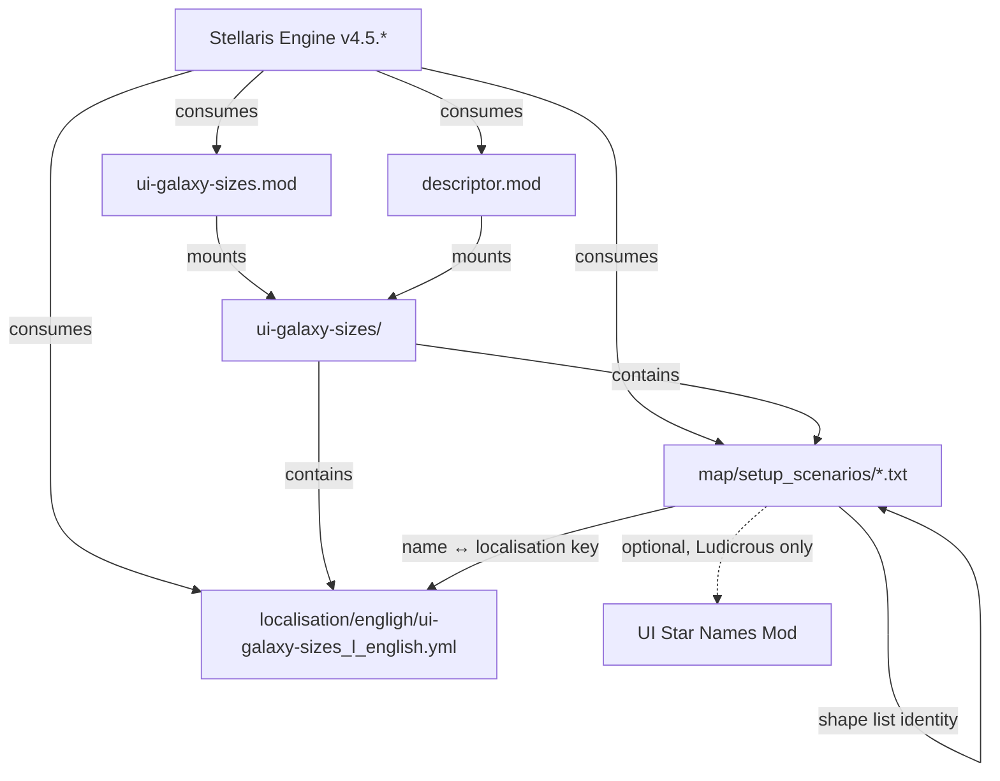

# Dependencies

## External Dependencies

### Stellaris Game Engine

| Aspect | Detail |
|--------|--------|
| **Name** | Stellaris |
| **Version Constraint** | `v4.5.*` (declared in both `.mod` files) |
| **Type** | Host platform / runtime |
| **Relationship** | The engine consumes the mod; the engine possesses execution |
| **Interface** | `setup_scenario` parameter blocks, the localisation system, mod descriptor parsing |
| **Compatibility** | Parameters validated against the engine version at generation time |

**Version Compatibility Matrix:**

| Mod Version | Stellaris Version | Status |
|-------------|-------------------|--------|
| 1.5.0 | 4.5.x | ✅ Supported |
| 1.3.0 | 3.x | ⚠️ Legacy (Paradox Mods only) |
| < 1.3.0 | < 3.x | ❌ Unsupported |

**Breaking Change Triggers:**
- Stellaris changes the `setup_scenario` schema
- Stellaris changes the mod descriptor format
- Stellaris changes the localisation format
- Stellaris removes or renames galaxy shapes
- Stellaris changes parameter validation bounds

### Universum Infinitum - Star Names

| Aspect | Detail |
|--------|--------|
| **Name** | Universum Infinitum - Star Names |
| **Repository** | https://github.com/hmlendea/stellaris-ui-star-names |
| **Type** | Optional companion mod |
| **Relationship** | Supplies an extended system name pool for 2,000-star galaxies |
| **Required For** | The Ludicrous scenario (2,000 stars) only |
| **Interface** | Stellaris name pool system (implicit) |

**Dependency Flow:**
```
Player selects Ludicrous → Generator checks for UI Star Names →
  If active: Uses the extended pool (2000+ unique names)
  If inactive: Uses the vanilla pool (~1000 names, duplicates)
```

**Failure Mode:** Graceful degradation — the game functions, but system names repeat.

## Internal Dependencies

### Mod Descriptor ↔ Mod Content

| Dependency | Direction | Description |
|------------|-----------|-------------|
| `ui-galaxy-sizes.mod` → `ui-galaxy-sizes/` | Mount | Root descriptor declares `path="mod/ui-galaxy-sizes"` |
| `ui-galaxy-sizes/descriptor.mod` → `ui-galaxy-sizes/` | Mount | The local descriptor declares an identical path |
| Both descriptors | Identity | Must carry identical `version`, `name`, `path`, `supported_version` |

### Scenario Files ↔ Localisation

| Dependency | Direction | Description |
|------------|-----------|-------------|
| `setup_scenario.name` → `l_english` key | Lookup | The engine maps the scenario `name` to a localisation key |
| Six scenario files → Six localisation records | 1:1 | Each scenario requires exactly one label |

**Consistency Rules:**
- The scenario `name` (e.g. `ui_ludicrous`) must correspond to the localisation key
- All six scenarios must possess localisation records
- An absent record → Raw key displayed in the UI

### Scenario Files ↔ Each Other

| Dependency | Direction | Description |
|------------|-----------|-------------|
| Priority ordering | Cross-file | Every `priority` value must be unique and monotonic |
| Shape support | Cross-file | All six must declare identical `supports_shape` lists |
| Parameter structure | Cross-file | All six must define an identical parameter set |

**Validation:**
- Priority collision → Undefined UI sort order
- Shape list divergence → Inconsistent shape availability
- Parameter omission → The engine uses defaults and logs warnings

## Dependency Graph



## Distribution Platform Dependencies

| Platform | Dependency | Notes |
|----------|------------|-------|
| Steam Workshop | Root descriptor (`ui-galaxy-sizes.mod`) | Primary distribution |
| GitHub Releases | Root descriptor + mod directory | Manual download |
| Nexus Mods | Root descriptor + mod directory | Manual download |
| Paradox Mods | Local descriptor (`descriptor.mod`) only | No root `.mod` |
| Manual Install | Local descriptor + mod directory | The user places them in the mod directory |

## Version Synchronisation Requirements

All version-bearing files must be updated together:

| Path | Version Field | Synchronisation Rule |
|------|---------------|----------------------|
| `ui-galaxy-sizes.mod` | `version` | Must correspond to the release tag |
| `ui-galaxy-sizes/descriptor.mod` | `version` | Must correspond to the root descriptor |
| GitHub Release | Tag | Must correspond to the descriptor version |
| Steam Workshop | Version | Must correspond to the descriptor version |
| Nexus Mods | Version | Must correspond to the descriptor version |

## Compatibility Testing Matrix

| Stellaris Version | Mod Version | UI Star Names | Test Status |
|-------------------|-------------|---------------|-------------|
| 4.5.0 | 1.5.0 | Any | ✅ Required |
| 4.5.1 | 1.5.0 | Any | ✅ Required |
| 4.5.x | 1.5.0 | Any | ✅ Required |
| 4.6.0 | 1.5.0 | Any | ❓ Untested |
| 3.x | 1.3.0 | Any | ⚠️ Legacy |
## Dependency Update Process

### Stellaris Version Update

1. Test the mod against the new Stellaris version (beta or PTS)
2. Verify every scenario parameter remains valid
3. Update `supported_version` in both `.mod` files
4. Update the `version` in both `.mod` files
5. Release the new mod version

### UI Star Names Update

1. No action required (backward compatible)
2. Verify Ludicrous still functions with the new version
3. Optional: Update the README with the new version reference

### Breaking Dependency Change

If Stellaris changes the `setup_scenario` schema:
1. Analyse the new schema
2. Update all six scenario files
3. Test every declared shape for all six sizes
4. Update `supported_version` and `version`
5. Release a major version bump
