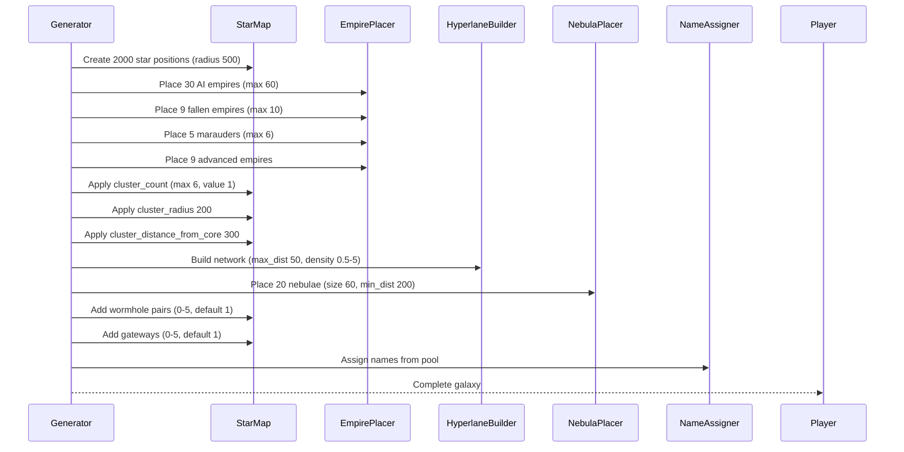
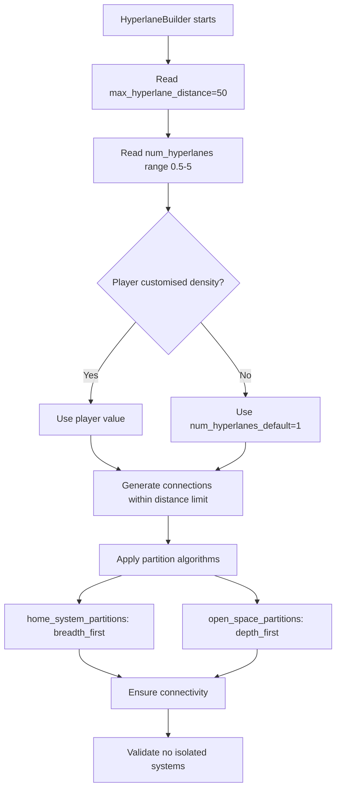
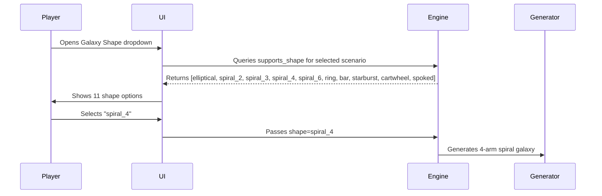
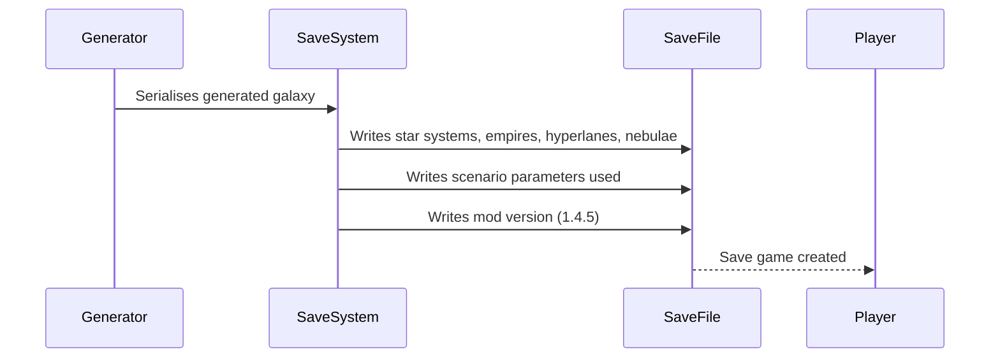
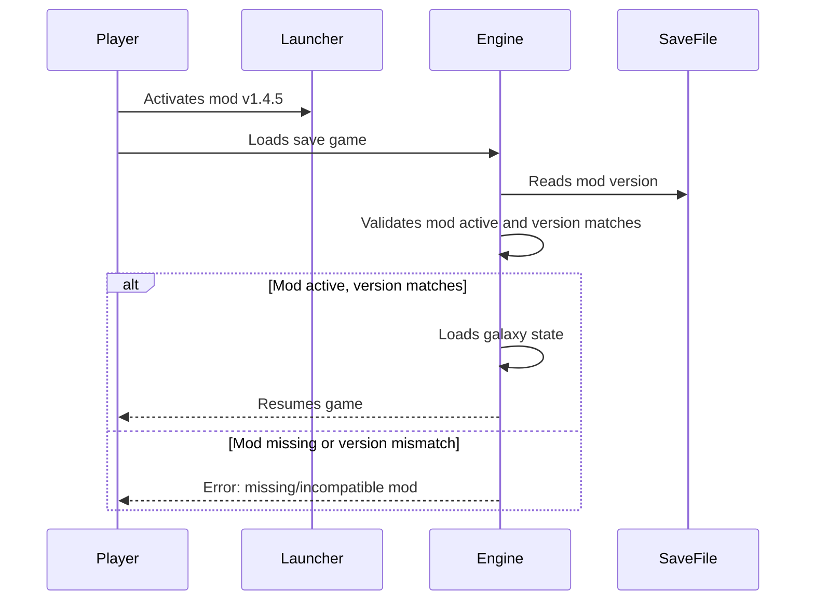

# Flows

## Galaxy Generation Detail Flow

### Parameter Application Sequence



### Empire Placement Detail

```mermaid
flowchart TD
    A[Generator starts empire placement] --> B[Read num_empires range]
    B --> C[Read num_empire_default]
    C --> D{Player customised count?}
    D -->|Yes| E[Use player value within range]
    D -->|No| F[Use num_empire_default]
    E --> G[Place empires using home_system_partitions]
    F --> G
    G --> H[Apply breadth_first partition method]
    H --> I[Ensure min_bridges 2, max_bridges 4]
    I --> J[Place fallen empires (fallen_empire_default)]
    J --> K[Place marauders (marauder_empire_default)]
    K --> L[Place advanced empires (advanced_empire_default)]
    L --> M[Validate all empires have valid home systems]
```

### Hyperlane Network Generation



### Crisis Strength Application

```mermaid
flowchart TD
    A[Generator applies crisis settings] --> B[Read crisis_strength=2.75]
    B --> C[Read extra_crisis_strength={10,25}]
    C --> D[Apply base multiplier to crisis fleets]
    D --> E[Apply extra scaling at crisis milestones]
    E --> F[Scale crisis spawn rates and fleet power]
```

## Shape Selection Flow

### Player Shape Choice



**Shape Support Invariants:**
- All six scenarios declare identical `supports_shape` list
- Engine filters UI to only show supported shapes
- No scenario restricts shapes differently

## Save Game Flow

### Galaxy Persistence



**Save Game Contents:**
- Complete galaxy state (stars, empires, fleets, etc.)
- Scenario parameters that generated it
- Mod version for compatibility checking
- No mod files embedded (mod must be active to load)

### Save Game Loading



**Compatibility Rules:**
- Save requires exact mod version that created it
- New mod version cannot load old saves (parameters may differ)
- Vanilla saves unaffected by mod presence